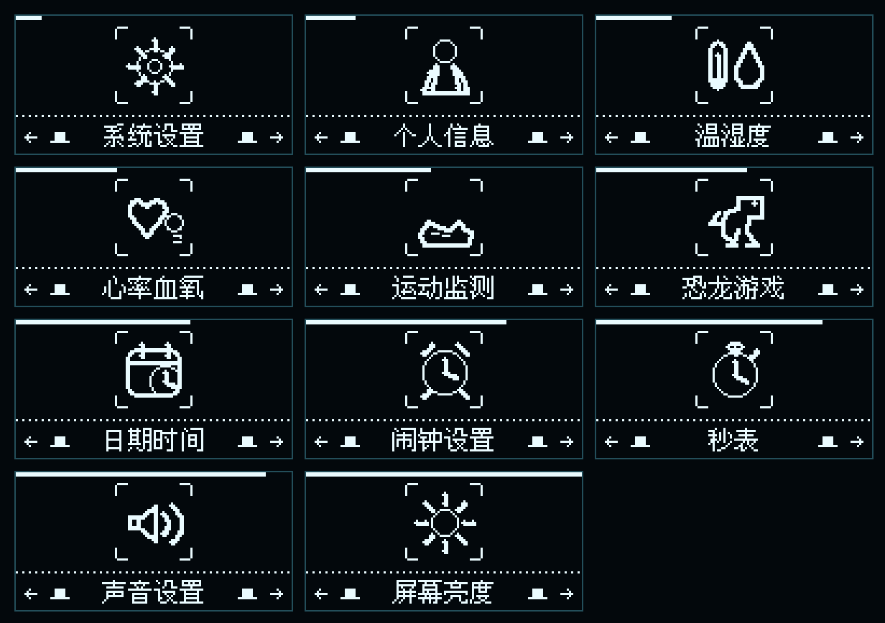
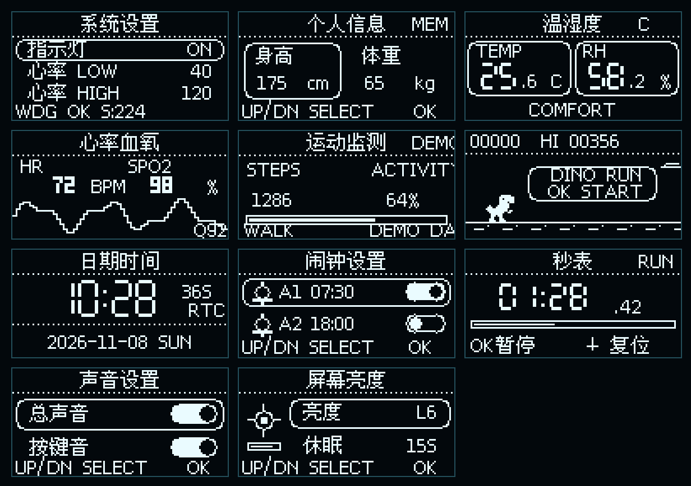
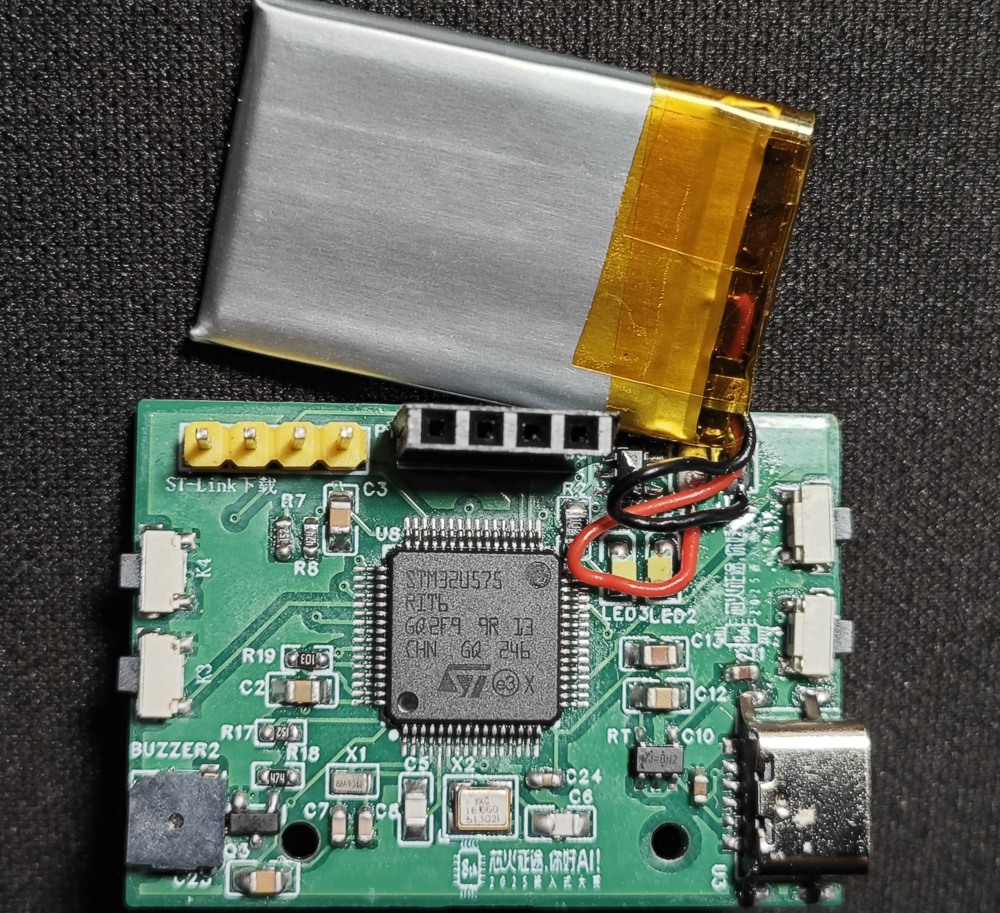
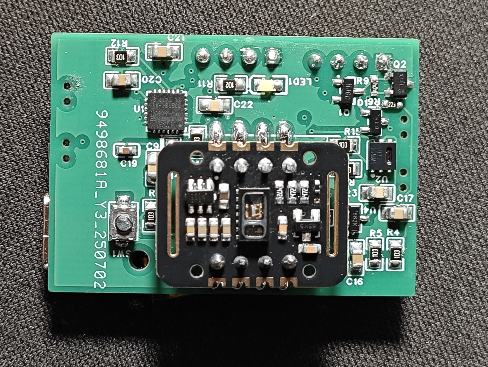
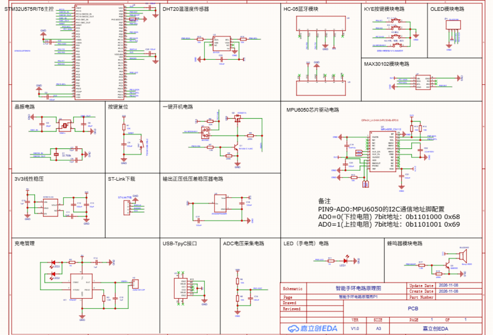

# AstraPulse

> 基于 STM32U575 与 FreeRTOS 的开源智能健康腕表
> An open-source STM32U575 + FreeRTOS smart health watch


当前稳定版本：`1.0.0`

AstraPulse 是一套从零重构的智能手表软硬件项目。固件使用 STM32U575RIT6、
FreeRTOS 和 Astra 风格单色 OLED UI，实现健康采集、时间闹钟、低功耗、游戏与
可持久设置。仓库同时提供固件源码、PCB/原理图资料和可打印的 STL 外壳。

## 功能

- 128×64 SSD1306 OLED：开机动画、主表盘、中文菜单与独立功能页
- MAX30102 心率/血氧采集、手指检测、进度与 PPG 波形
- SHT20/DHT20 温湿度采集，MPU6050 运动管线与自检
- RTC 日期时间、双闹钟、秒表与闹钟深度休眠唤醒
- 四键导航、声音/亮度设置、个人信息与恐龙游戏
- FreeRTOS 静态任务、分层架构、双页 CRC Flash 日志
- Tickless Idle + STM32 STOP2、四键 EXTI 唤醒、独立看门狗与任务栈监控
- Windows PowerShell 一键构建、校验、打包与 ST-Link 烧录

## 软件效果

二级菜单包含 11 个带动画选择框的功能图标：



各项功能使用独立的 128×64 OLED 界面：



完整尺寸的单页图片和可重复生成素材的渲染脚本见
[软件效果图](软件效果图/README.md)。

## 快速开始

需要 Windows 10/11、CMake 3.25+、Ninja、Arm GNU Toolchain 和
STM32CubeProgrammer。在项目根目录执行：

```powershell
powershell.exe -NoProfile -ExecutionPolicy Bypass -File .\scripts\build.ps1 -Configuration release -Clean
powershell.exe -NoProfile -ExecutionPolicy Bypass -File .\scripts\flash.ps1 -Configuration release
```

程序会生成 `build/release/watch_astra.elf`/`.hex`/`.bin`，烧录脚本会先校验
SHA256，再写入、校验并复位。详细操作参见 [构建、烧录与恢复](docs/OPERATIONS.md)。

## 按键

| 引脚 | 功能 |
|---|---|
| PC12 | 上一项 |
| PA4 | 下一项 |
| PC11 | 返回/退出 |
| PA5 | 进入/确认/执行 |

## 项目结构

```text
App/            系统入口与 FreeRTOS 任务组装
BSP/            STM32U575 时钟、引脚、总线、ADC 与中断
Drivers/        STM32 HAL/CMSIS
Platform/       Astra UI 与显示平台适配
Services/       时间、健康、环境、存储、电源与声音服务
UI/             表盘、菜单、功能页和游戏
Assets/         中文字模与图形资源
hardware/       PCB/原理图工程、实物图和 STL 外壳
软件效果图/      开机 GIF、菜单图标与功能页预览
docs/           架构、硬件、验收、发布与维护文档
scripts/        构建、烧录和发布脚本
ThirdParty/     FreeRTOS 与精简的 oled-ui-astra 依赖
```

分层、任务优先级和 Flash 布局见 [软件架构](docs/ARCHITECTURE.md)，引脚定义见
[硬件契约](docs/HARDWARE.md)，实机结果见 [1.0.0 验收记录](docs/ACCEPTANCE.md)。

## 硬件资料

- [PCB、原理图与实物图](hardware/pcb/README.md)
- [3D 打印外壳](hardware/enclosure/README.md)

| PCB 正面 | PCB 背面 |
|---|---|
|  |  |

### 整机原理图



## 已知限制

- 当前样机的 MPU6050/I2C4 硬件无法应答，运动页以 `DEMO` 显示示例数据。
- 电池百分比尚未针对目标电池标定，无电池时显示 `--` 属于预期行为。
- 心率和血氧是消费级估算，不得用于医疗诊断。
- RTC 使用内部 LSI，长期精度低于外部 LSE 晶振。

## 许可证

AstraPulse 因基于 GPL-3.0 的 oled-ui-astra 进行适配，整体以
[GNU GPL-3.0](LICENSE) 开源。第三方组件及字体的许可说明见 [THIRD_PARTY.md](THIRD_PARTY.md)。

## 致谢

- [oled-ui-astra](https://github.com/AstraThreshold/oled-ui-astra)
- [FreeRTOS Kernel](https://github.com/FreeRTOS/FreeRTOS-Kernel)
