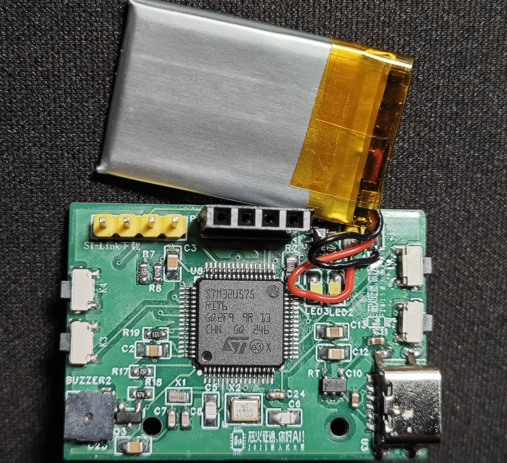
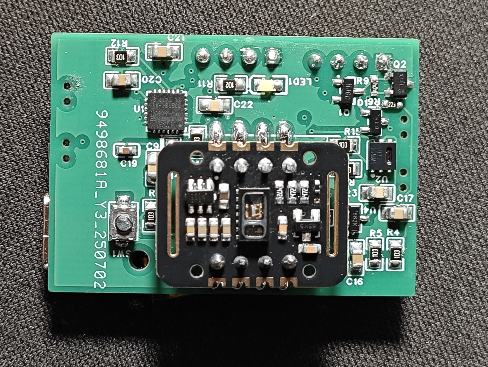
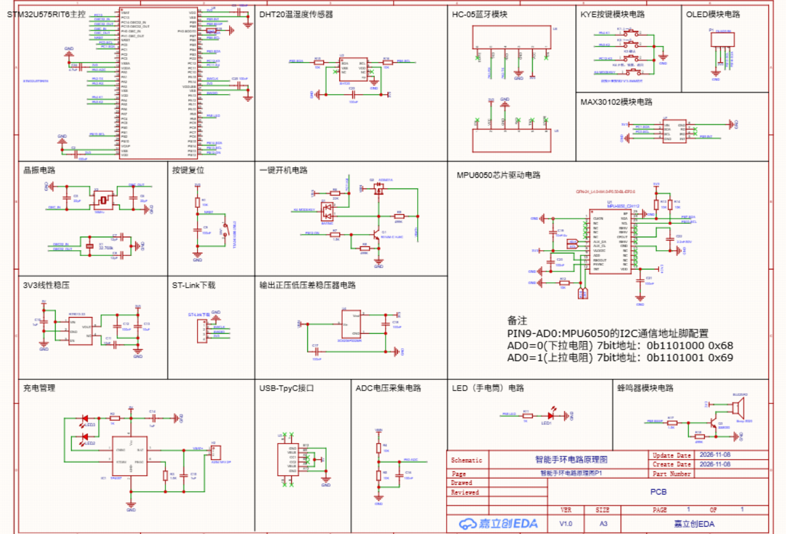

# PCB 与原理图

| 文件 | 内容 |
|---|---|
| `AstraPulse.epro` | 嘉立创 EDA 工程包 |
| `schematic.png` | 整机原理图导出图 |
| `pcb-front.jpg` | PCB 正面实物图 |
| `pcb-back.jpg` | PCB 背面实物图 |

## ST-Link 连接

| ST-Link | 手表主板 |
|---|---|
| SWDIO | PA13 / SWDIO |
| SWCLK | PA14 / SWCLK |
| GND | GND |
| 3.3 V | VCC（仅在确认供电方案后连接） |

主板必须共地并保持稳定供电。普通烧录使用 SWDIO、SWCLK 和 GND 即可；
如额外引出 NRST，可在连接困难时使用 Under Reset 模式。

