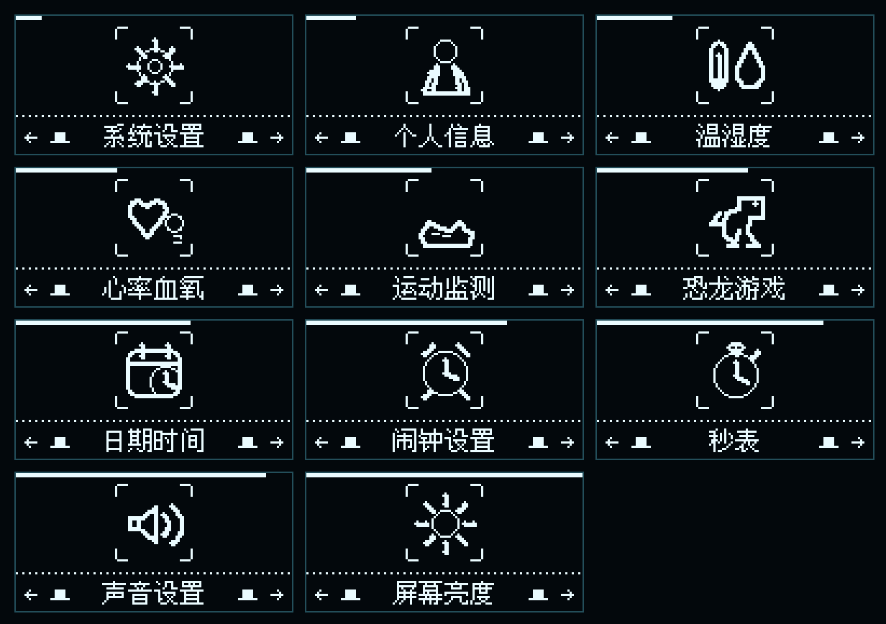
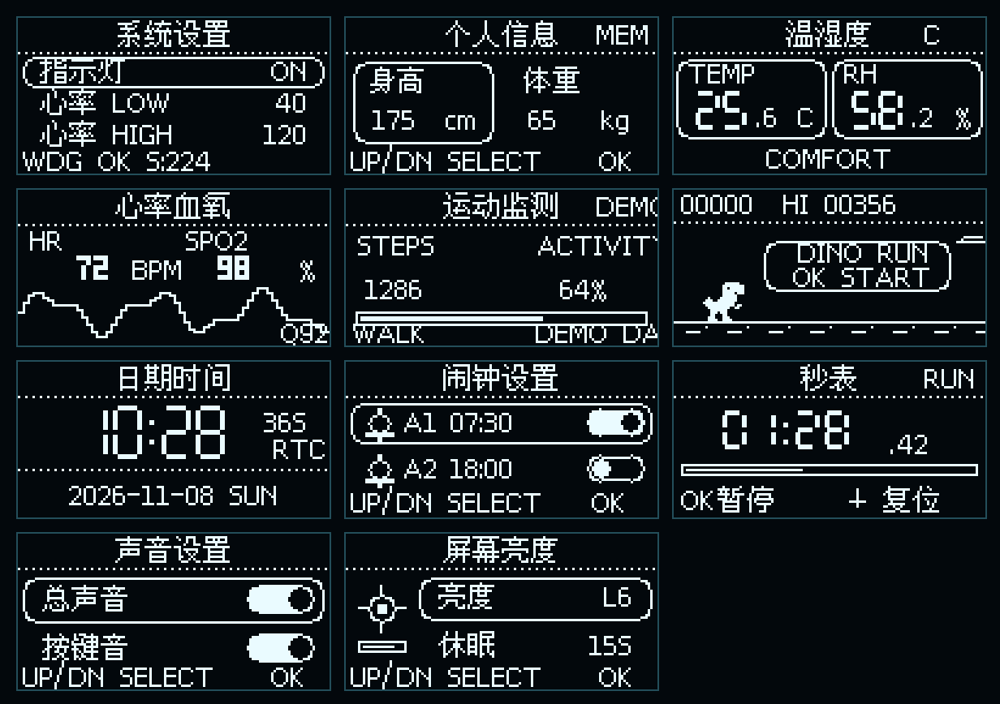

# AstraPulse 软件效果图

本目录的界面图由 `tools/render_software_effects.js` 根据固件中的 OLED 布局、
中文字模、二级菜单图标和恐龙精灵确定性渲染，不是 AI 概念图。
图中日期、时间和传感器数值用于展示排版，不代表一次特定的实机采样。

## 快速预览






## 文件结构

- `开机动画-主表盘.gif`：13 帧开机表情动画与主表盘交接。
- `主表盘.png`：主界面静态图。
- `二级菜单图标总览.png`：11 个菜单图标的 README 总览。
- `功能页面总览.png`：11 个功能页的 README 总览。
- `菜单图标/`：每个二级菜单的独立 516×260 PNG。
- `功能页面/`：每个功能页的独立 516×260 PNG。

重新生成：

```powershell
node .\tools\render_software_effects.js
```
